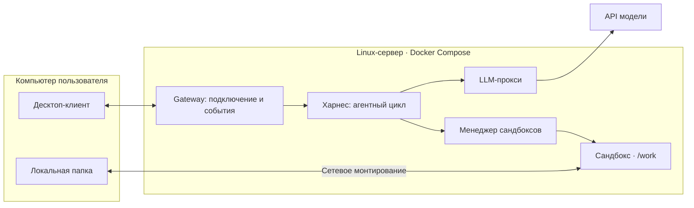

# AgentRuntimeEnvironment: среда исполнения агента

## Что это

Проект по [заданию A курса ИТМО × DeepPavlov](https://github.com/deeppavlov/agentic-course-itmo/blob/main/projects/A-agent-runtime.md):
десктоп-клиент подключается к серверу, агент исполняет команды в сандбоксе
и работает с локальной папкой клиента через сетевое монтирование.

**Работает первый агентный сценарий:** gateway → собственный харнес → LLM-прокси →
Docker-сандбокс. Есть чат на PySide6 и консольный клиент, чтение, diff и подтверждение записи/команд,
SSE, отмена и очистка. Реальная Qwen проверена на синтетическом файле.
Настоящее монтирование папки Mac ещё не реализовано.
Стек сервера — Python/FastAPI и HTTP/JSON + SSE; клиент — PySide6.
Монтирование WebDAV/rclone рассматривается как кандидат, а не принятое решение.

Репозиторий следует [официальному шаблону](https://github.com/deeppavlov/agentic-course-itmo/tree/main/projects/templates/track-a-agent-runtime).
Прогресс — [TASKS.md](TASKS.md), причины изменений — [журнал](docs/action-log.md),
простое объяснение задачи — [docs/project.md](docs/project.md).

## Архитектура



Это целевая схема. В Compose работают все четыре серверных компонента,
одноразовый sandbox-image проверяет образ агента. Контейнеры сессий создаёт менеджер.
Папка пока заменена временной учебной фикстурой.
[ADR-0003](docs/adr/0003-course-template.md) описывает структуру,
[ADR-0002](docs/adr/0002-workdir-mount.md) — предложение по монтированию.
Статусы остальных решений — в [docs/adr/](docs/adr/README.md).

## Запуск сервера

Нужны Git, [uv](https://docs.astral.sh/uv/getting-started/installation/), Make
и запущенный Docker с Compose v2 (на Mac — Docker Desktop).
Python 3.13.15 и зависимости закреплены; используем uv 0.12.12.

```bash
git clone https://github.com/HermanDp45/AgentRuntimeEnvironment.git
cd AgentRuntimeEnvironment
make setup
docker compose up --build
```

`make setup` выполняет `uv sync --frozen` и создаёт `.env` из `.env.example`,
не перезаписывая существующий файл. Compose запускается и без `.env`.
Используются `GATEWAY_PORT` (8080) и `SANDBOX_MANAGER_PORT` (8081), оба на loopback.
Лимиты — в config.toml харнеса и сандбокс-менеджера. Для реальных задач настройте
LLM_PROVIDER_URL, LLM_MODEL и LLM_API_KEY в локальном .env: ключ получает только llm-proxy.
Без ключа сервисы запускаются, но запрос к модели завершается понятной ошибкой.
CLIENT_TOKENS задаёт клиентские токены через запятую; локальное значение по умолчанию — local-dev-token.

В другом терминале:

```bash
curl --fail http://127.0.0.1:8080/health
curl --fail http://127.0.0.1:8081/health
make test-infra
docker compose down -v --remove-orphans
```

Ожидаемый ответ: `{"status":"ok"}`. `make up` ждёт healthy, `make down` выполняет очистку.
Локально без контейнера: `make run`, адрес `127.0.0.1:8080`, остановка — `Ctrl+C`.
Dockerfile каждого компонента находится в его каталоге; build context — корень с общим lock-файлом.

## Клиент

Базовый чат: сообщения, журнал действий и вывод команд, diff и кнопки разрешения/отказа,
отмена и просмотр файлов после задачи. После запуска сервера:

```bash
make setup-gui
make gui
```

Нажмите «Подключить чат» и отправьте, например: «Прочитай note.txt и замени original на changed».
Следующие сообщения используют ту же сессию и историю. Ответы модели появляются целиком;
вывод команд приходит по мере выполнения. Запись и команды ждут отдельного разрешения.
Закрытие окна удаляет учебную папку и освобождает сандбокс.

Консольный одноразовый сценарий также сохранён:

```bash
uv run --frozen --offline python -m client.cli
```

Он создаёт учебный note.txt с текстом original и просит модель заменить его на changed.
После разрешения показывается результат и файлы; закрытие удаляет временную фикстуру.
Папка Mac не затрагивается. Для собственного токена задайте CLIENT_TOKEN, адрес — через --url.
[Команды и ограничения клиента](client/README.md), [как работает цикл](docs/harness.md).

Для LLM-прокси включён DNS через TCP (dns_opt: use-vc): в текущей VPN-сети
публичные DNS не отвечают по UDP. Обычный make up уже содержит исправление;
ручной IP, DNS-overlay и изменение настроек VPN не нужны.
[Проверка без ручного IP](results/2026-11-06-dns-fix/README.md),
[диагностика причины](results/2026-11-06-dns-investigation/README.md).

Базовый GUI ещё не выбирает папку Mac и не восстанавливает историю после перезапуска.
Сетевое монтирование будет отдельным этапом; после него правки окажутся в выбранной папке.

## Тесты

| Команда | Что запускает |
|---|---|
| `make check` | Согласованность lock-файла, Ruff и проверку форматирования |
| `make test-ci` | Lock/Ruff и unit-тесты контрактов, харнеса, прокси, gateway и сандбокса, без внешней сети |
| `make test-ui` | QtTest: чат против mock HTTP/SSE, после `make setup-gui` |
| `make test-infra` | Только прямые HTTP-тесты сандбокса на обычном Compose, без LLM |
| `make up-test` / `make test-agent` / `make down-test` | Отдельный offline-стенд: вся серверная цепочка с mock LLM, сандбокс и CLI |
| `make baf-smoke` | Пока недоступно: одна simple-задача на каждую БАФ, 1 повтор |
| `make baf PAIR=<harness>+<model>` | Пока недоступно: полный БАФ для пары, 3 повтора |
| `make bench-fs` | Пока недоступно: замеры монтирования A-3.6 |
| `make bench-sandbox` | Пока недоступно: замеры сандбокса A-5.6 |

Недоступные цели завершаются ошибкой, а не изображают успешную проверку.
Полный `test-ci` по A-8 должен включать UI + инфраструктуру + smoke-БАФ;
UI монтирования, сбои процессов и smoke-БАФ ещё предстоит реализовать. После `make setup` текущие проверки работают offline.

GitHub Actions отдельно запускает UI без экрана и собирает Compose на Linux, ждёт healthy, проверяет `/health`,
выполняет HTTP-тесты сандбокса и проверку перезапуска/очистки менеджера.
Локальный make test-ci явно пропускает Docker-сценарии. Все девять запускаются
через make up-test и make test-agent на отдельных loopback-портах 18080/18081.
Тестовый стенд проверяет свой mock URL до запросов и не использует реальный ключ.
После сборки он не обращается к внешним сервисам.
Настроены push, pull request и ручной запуск; ранее подтверждены ручные запуски,
автоматический push-запуск пока не подтверждён. Результаты — в [docs/report.md](docs/report.md).

## Структура

```text
services/          gateway, harness, sandbox-manager, llm-proxy
client/            PySide6-чат, CLI и общий HTTP/SSE-транспорт
contracts/         схемы обоих протоколов с версиями
baf/               курсовой каталог, пример Б1.1; далее остальные и свои задачи
tests/unit/        контракты, харнес, транспорт, gateway, proxy и файлы
tests/ui/          QtTest против mock HTTP/SSE и опционально Compose
tests/infra/       весь сервер с mock LLM, настоящий Docker, CLI и перезапуск
docs/adr/          решения и шаблон ADR
docs/harness.md    карта реализации харнеса
docs/baf.md        свои БАФ и обоснование
docs/report.md     замеры, матрица БАФ × пара, выводы
results/           сырые результаты и команды воспроизведения
```

Исходники и Dockerfile каждого реализованного сервиса находятся в его каталоге.
Папки будущих компонентов содержат описание статуса, без фиктивных сервисов.
Дополнительно: [AGENTS.md](AGENTS.md), [TASKS.md](TASKS.md), [журнал действий](docs/action-log.md).

## Модели

Временный доступ к Qwen/Qwen3-235B-A22B-Instruct-2507 через inference.airi.net
проверен сначала отдельно, затем через gateway, харнес, proxy и настоящий сандбокс.
[Первый агентный прогон](results/2026-11-06-harness-v0/README.md) — чтение фикстуры,
не оценка качества и не официальный БАФ. В offline CI используется сценарная модель.
Для официальных БАФ пары ещё не выбраны. При выборе проверяем разрешённость
по [общим правилам курса](https://github.com/deeppavlov/agentic-course-itmo/blob/main/projects/README.md#0-1-модели),
записываем модель, версию, AA Intelligence Index и дату проверки в [отчёт](docs/report.md).
Пока результатов агента и матрицы сравнения нет; наличие примера БАФ не означает его прохождение.
Секреты хранятся только локально; исходные результаты — в Git после удаления секретов.

К ЧП1: [официальные вопросы](https://github.com/deeppavlov/agentic-course-itmo/blob/main/projects/checkpoint-1-questions.md)
— общий блок и направление «Без арены».
[Ответы по нашему решению и демонстрация](docs/checkpoint-1-answers.md);
общее объяснение — в [разборе проекта](docs/project.md).
