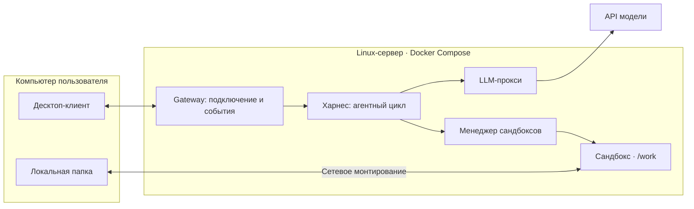

# AgentRuntimeEnvironment: среда исполнения агента

## Что это

Проект по [заданию A курса ИТМО × DeepPavlov](https://github.com/deeppavlov/agentic-course-itmo/blob/main/projects/A-agent-runtime.md):
десктоп-клиент подключается к серверу, агент исполняет команды в сандбоксе
и работает с локальной папкой клиента через сетевое монтирование.

**Сейчас работают gateway (`GET /health`) и менеджер сандбоксов v0.**
Есть схемы двух контрактов, HTTP/SSE для сандбокса, файлы, команды, отмена и очистка.
Харнес, LLM-прокси, клиент и настоящее монтирование ещё не реализованы.
Стек основы — Python/FastAPI; планируемый клиент — PySide6, выбран собственный небольшой харнес.
Монтирование WebDAV/rclone рассматривается как кандидат, а не принятое решение.

Репозиторий следует [официальному шаблону](https://github.com/deeppavlov/agentic-course-itmo/tree/main/projects/templates/track-a-agent-runtime).
Прогресс — [TASKS.md](TASKS.md), причины изменений — [журнал](docs/action-log.md),
простое объяснение задачи — [docs/project.md](docs/project.md).

## Архитектура



Это целевая схема. В Compose работают gateway и sandbox-manager; одноразовый
sandbox-image собирает и проверяет образ. Контейнеры сессий создаёт сам менеджер.
[ADR-0003](docs/adr/0003-course-template.md) описывает структуру,
[ADR-0002](docs/adr/0002-workdir-mount.md) — предложение по монтированию.
Статусы остальных решений — в [docs/adr/](docs/adr/README.md).

## Запуск сервера

Нужны Git, [uv](https://docs.astral.sh/uv/getting-started/installation/), Make
и запущенный Docker с Compose v2 (на Mac — Docker Desktop).
Python 3.13.15 и зависимости закреплены; используем uv 0.12.12.

```bash
git clone https://github.com/HermanDp45/AgentRuntimeEnvironment.git
cd AgentRuntimeEnvironment
make setup
docker compose up --build
```

`make setup` выполняет `uv sync --frozen` и создаёт `.env` из `.env.example`,
не перезаписывая существующий файл. Compose запускается и без `.env`.
Используются `GATEWAY_PORT` (8080) и `SANDBOX_MANAGER_PORT` (8081), оба на loopback.
Параметры модели и прочие переменные шаблона пока не подключены; действующие лимиты —
в `services/sandbox-manager/config.toml`. Ключ API не нужен, ни одному контейнеру не передаётся.

В другом терминале:

```bash
curl --fail http://127.0.0.1:8080/health
curl --fail http://127.0.0.1:8081/health
make test-infra
docker compose down -v --remove-orphans
```

Ожидаемый ответ: `{"status":"ok"}`. `make up` ждёт healthy, `make down` выполняет очистку.
Локально без контейнера: `make run`, адрес `127.0.0.1:8080`, остановка — `Ctrl+C`.
Dockerfile каждого компонента находится в его каталоге; build context — корень с общим lock-файлом.

Менеджер создаёт сессию → принимает ReadFile/WriteFile/RunCommand → отдаёт SSE и результат
→ collect выгружает файлы → release удаляет контейнер. Пока `/work` — временная учебная
папка, не папка Mac: после удаления контейнера она исчезает. Контейнер агента работает
без сети и ключей; Docker socket доступен только доверенному менеджеру. Подтверждения
записи и команд появятся в харнесе. [Код и границы](services/sandbox-manager/README.md),
[маршруты и форматы](contracts/README.md), локальная форма запросов — `http://127.0.0.1:8081/docs`.

## Клиент

Клиент пока отсутствует, поэтому команд сборки и работающего монтирования нет.
Согласован интерфейс: чат, просмотр изменений и подтверждение применения правок.
Будущий сценарий: выбрать папку, отправить задачу, увидеть вызовы инструментов,
получить изменённый файл в своей папке; отмена и переподключение доступны из клиента.
План GUI и headless-режима — в [client/README.md](client/README.md).

## Тесты

| Команда | Что запускает |
|---|---|
| `make check` | Согласованность lock-файла, Ruff и проверку форматирования |
| `make test-ci` | Check + unit-тесты gateway, контрактов, файлов и сессий, без внешней сети |
| `make test-ui` | Пока недоступно: микросценарии клиента против mock-сервера |
| `make test-infra` | HTTP-тесты настоящего сандбокса; нужен запущенный Compose, LLM не используется |
| `make baf-smoke` | Пока недоступно: одна simple-задача на каждую БАФ, 1 повтор |
| `make baf PAIR=<harness>+<model>` | Пока недоступно: полный БАФ для пары, 3 повтора |
| `make bench-fs` | Пока недоступно: замеры монтирования A-3.6 |
| `make bench-sandbox` | Пока недоступно: замеры сандбокса A-5.6 |

Недоступные цели завершаются ошибкой, а не изображают успешную проверку.
Полный `test-ci` по A-8 должен включать UI + инфраструктуру + smoke-БАФ;
эти три части ещё предстоит реализовать. После `make setup` текущие проверки работают offline.

GitHub Actions собирает Compose на Linux, ждёт healthy, проверяет `/health`,
выполняет HTTP-тесты сандбокса и проверку перезапуска/очистки менеджера.
Локальный `make test-ci` пропускает четыре Docker-сценария: они отдельно запускаются
через `make test-infra`, а не считаются успешными unit-проверками.
Настроены push, pull request и ручной запуск; ранее подтверждены ручные запуски,
автоматический push-запуск пока не подтверждён. Результаты — в [docs/report.md](docs/report.md).

## Структура

```text
services/          gateway, harness, sandbox-manager, llm-proxy
client/            десктоп-клиент и headless/CLI-режим
contracts/         схемы обоих протоколов с версиями
baf/               курсовой каталог, пример Б1.1; далее остальные и свои задачи
tests/unit/        gateway, контракты, файловые операции, сессии
tests/ui/          сценарии интерфейса (пока описание)
tests/infra/       HTTP-сценарии сандбокса и проверка перезапуска
docs/adr/          решения и шаблон ADR
docs/harness.md    карта реализации харнеса
docs/baf.md        свои БАФ и обоснование
docs/report.md     замеры, матрица БАФ × пара, выводы
results/           сырые результаты и команды воспроизведения
```

Исходники и Dockerfile каждого реализованного сервиса находятся в его каталоге.
Папки будущих компонентов содержат описание статуса, без фиктивных сервисов.
Дополнительно: [AGENTS.md](AGENTS.md), [TASKS.md](TASKS.md), [журнал действий](docs/action-log.md).

## Модели

Временный доступ к `Qwen/Qwen3-235B-A22B-Instruct-2507` через `inference.airi.net`
проверен отдельно: текст и tool_call работают. [Проверка и результаты](services/llm-proxy/README.md).
Модель ещё не встроена в сервер, харнес отсутствует; инструмент в проверке не исполнялся.
Для официальных БАФ пары ещё не выбраны. При выборе проверяем разрешённость
по [общим правилам курса](https://github.com/deeppavlov/agentic-course-itmo/blob/main/projects/README.md#0-1-модели),
записываем модель, версию, AA Intelligence Index и дату проверки в [отчёт](docs/report.md).
Пока результатов агента и матрицы сравнения нет; наличие примера БАФ не означает его прохождение.
Секреты хранятся только локально; исходные результаты — в Git после удаления секретов.

К ЧП1: [официальные вопросы](https://github.com/deeppavlov/agentic-course-itmo/blob/main/projects/checkpoint-1-questions.md)
— общий блок и направление «Без арены». Что готовить и показывать — в [разборе проекта](docs/project.md).
