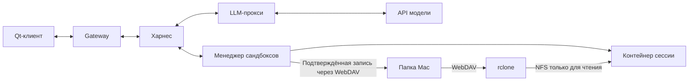

# AgentRuntimeEnvironment: среда исполнения агента

## Что это

Десктоп-клиент даёт агенту доступ к выбранной папке. Пользователь видит команды и diff в чате и решает, разрешить ли выполнение. Агент работает в отдельном Docker-контейнере. Проект выполняет [задание A курса ИТМО × DeepPavlov](https://github.com/deeppavlov/agentic-course-itmo/blob/main/projects/A-agent-runtime.md).

| К ЧП2, 18 ноября | Что проверено |
|---|---|
| Чат и папка на Mac | На Docker Desktop агент читает файл, показывает diff и после подтверждения меняет файл на диске. Правка сохраняется после закрытия окна. [Сквозной тест](tests/ui/test_chat.py) |
| Отдельный Linux-сервер | Проверены двусторонний доступ к экспорту Mac по SSH и запуск части smoke на серверных фикстурах. Подключение выбранной папки из GUI к удалённому сандбоксу остаётся открытым. [Экспорт](results/2026-11-15-readiness/README.md) · [Smoke](results/2026-11-15-remote-server/README.md) |
| Изоляция и CI | У контейнера агента отключена сеть, ограничены CPU, память и процессы. CI проверяет ограничения, Qt-клиент, smoke-БАФ и очистку после сбоев. [Тесты](tests/infra/) |
| Первая пара «харнес + модель» | Собственный харнес с DeepSeek прошёл 90 из 117 попыток. Набор включает 39 задач, каждую выполнили трижды. [Исходные результаты](results/2026-11-18-deepseek-full/README.md) |

## Архитектура



Путь одной правки разобран [по исходникам](docs/project.md). Ограничения монтирования и причины выбора транспорта описаны в [ADR-0010](docs/adr/0010-local-workdir.md).

## Запуск сервера

В корне клона нужны Git, Make, uv и запущенный Docker с Compose v2. На Mac проверен Docker Desktop.

```bash
make setup
make setup-gui
```

Для чата с моделью курса укажите в локальном `.env` адрес `LLM_PROVIDER_URL=https://litellm-backend.deeppavlov.ai`, модель `LLM_MODEL=deepseek-ai/DeepSeek-V4.1-Flash-1017` и выданный `LLM_API_KEY`. Ключ получает сервис llm-proxy.

```bash
make up
curl --fail http://127.0.0.1:8080/health
```

## Клиент

1. Запустите `make gui`. Создайте демонстрационную папку с файлом `note.txt` и текстом `original`.
2. Нажмите «Выбрать папку…», укажите этот каталог и нажмите «Подключить чат».
3. Попросите «Замени original на changed в note.txt». Сверьте diff, разрешите запись и откройте файл на Mac.
4. Закройте окно и выполните `make down`. Файл останется в выбранной папке.

Сборка приложения для macOS arm64 — `make build-client`. Результат — `dist/AgentRuntime.app`. [Клиент, CLI и headless-сценарий](client/README.md).

## Тесты

| Команда из корня проекта | Что проверяет |
|---|---|
| `make test-unit` | Lock-файл, стиль и unit-тесты |
| `make test-ci` | Отдельный Compose с mock LLM, unit, инфраструктура, mock UI, 11 smoke-задач, аварийный перезапуск и очистка |
| `HARNESS_TEST_URL=http://127.0.0.1:18080 make test-ci` | На Mac дополнительно выполняет два Qt-сценария с настоящим сандбоксом, включая выбранную папку |
| `make baf` | С работающим обычным Compose выполняет 39 задач × 3 повтора на настроенной модели и расходует её API-бюджет |

Для тестов нужны зависимости из `make setup-gui`. CI использует сценарные ответы модели. Для точного повторения измеренной кампании DeepSeek есть [отдельная команда](results/2026-11-18-deepseek-full/README.md).

## Структура

- [client/](client/) — интерфейс, транспорт, экспорт папки. [services/](services/) — gateway, харнес, LLM-прокси и менеджер сандбоксов.
- [contracts/](contracts/) — версии и схемы протоколов. [tests/](tests/) — тесты компонентов, интерфейса и инфраструктуры.
- [baf/](baf/) — задания, фикстуры, чекеры и раннер. [results/](results/) — исходные данные и воспроизведение.
- [TASKS.md](TASKS.md) — выполненное и открытое с доказательствами. [docs/adr/](docs/adr/) — архитектурные решения.

## Модели

Первая полная кампания выполнена на `deepseek-ai/DeepSeek-V4.1-Flash-1017`. Для сравнения трёх пар предстоят ещё две кампании и интеграция второго харнеса. Замеры файловой системы и сандбокса также открыты. [Матрица, метрики и ошибки](docs/report.md).
