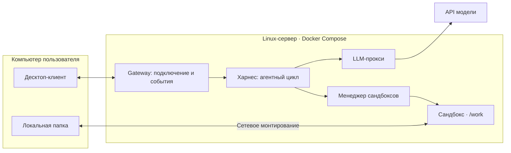

# AgentRuntimeEnvironment

Среда исполнения агента для курса [Agentic LLM Systems, ИТМО × DeepPavlov](https://github.com/deeppavlov/agentic-course-itmo).
Проект по [заданию A](https://github.com/deeppavlov/agentic-course-itmo/blob/main/projects/A-agent-runtime.md):
десктоп-клиент, удалённый сервер и изолированная работа с локальной папкой пользователя.

## Сейчас работает

Минимальный gateway на Python/FastAPI: `GET /health` возвращает `{"status":"ok"}`.
Есть запуск через Docker Compose, закреплённая среда и CI.
Харнес, сандбоксы, монтирование и десктоп-клиент ещё предстоит реализовать.
Прогресс и свидетельства проверок — в [TASKS.md](TASKS.md).

## Как это будет работать

Вы выбираете папку на Mac и пишете: «Найди настройку порта и измени её на 9000».
Клиент подключается к серверу и монтирует выбранную папку в сандбокс как `/work`.
Модель предлагает действия, харнес выполняет их через сандбокс и возвращает модели вывод.
В клиенте виден ход работы; изменённый файл сразу доступен на Mac. Запуск можно отменить.



Это целевая схема. Сейчас реализован только health endpoint gateway.
Зачем нужны остальные компоненты и в каком порядке их делать — в [разборе проекта](docs/project.md).

## Подготовка среды

Нужны Git, [uv](https://docs.astral.sh/uv/getting-started/installation/), Make;
для контейнеров — запущенный Docker с Compose v2. На Mac подойдёт Docker Desktop.
Python 3.13.15 указан в `.python-version`; `uv` установит его при необходимости.
Для воспроизводимости используем uv 0.12.12, зависимости закреплены в `uv.lock`.

```bash
git clone https://github.com/HermanDp45/AgentRuntimeEnvironment.git
cd AgentRuntimeEnvironment
make setup
```

`make setup` выполняет `uv sync --frozen` и создаёт `.env` из `.env.example`,
если файла ещё нет. Для первого запуска API-ключ не нужен.
Повторный `make setup` сохраняет ваш `.env`.

## Запуск

Локально, после подготовки среды:

```bash
make run
```

Gateway слушает `127.0.0.1:8080`. Остановка — `Ctrl+C`.

В контейнере, из корня репозитория:

```bash
docker compose up --build
```

Compose работает и без `.env`. Его единственная настройка сейчас — `GATEWAY_PORT`
(по умолчанию `8080`); она меняет внешний порт контейнера. `make run` использует `8080`.

В другом терминале:

```bash
curl --fail http://127.0.0.1:8080/health
```

Ожидаемый ответ: `{"status":"ok"}`. Полная остановка Compose:

```bash
docker compose down -v --remove-orphans
```

## Проверки

```bash
make check
make test-ci
```

`make check` проверяет согласованность lock-файла, Ruff и форматирование.
`make test-ci` дополнительно проверяет HTTP-контракт `/health` в памяти, без API модели.
После установки зависимостей обе команды работают без внешней сети и не меняют lock-файл.
UI-, инфраструктурные и smoke-БАФ тесты будут добавляться вместе с соответствующей реализацией.

GitHub Actions на push и pull request запускает `make test-ci`,
а отдельная Linux-проверка собирает Compose, ждёт healthy и проверяет `/health`.

## Материалы проекта

- [TASKS.md](TASKS.md) — задачи с отдельными отметками выполнения и проверки.
- [docs/project.md](docs/project.md) — объяснение задания, этапы и необходимые ресурсы.
- [docs/adr/](docs/adr/README.md) — архитектурные решения и предложения.
- [docs/action-log.md](docs/action-log.md) — причины изменений и результаты проверок.
- [results/](results/README.md) — правила хранения сырых результатов и отчётов.
- `src/agent_runtime/` — текущая реализация; `tests/` — её проверки.
- [AGENTS.md](AGENTS.md) — правила работы с репозиторием.

Репозиторий публичный: для доступа преподавателя достаточно его ссылки.
Секреты хранятся локально, результаты экспериментов — в Git после удаления секретов
и пользовательских данных. Готовые результаты БАФ пока отсутствуют.
