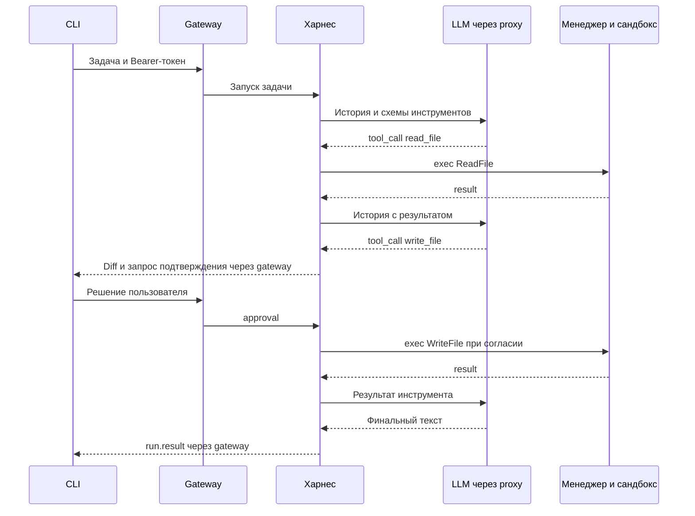

# Ответы к первому чекпоинту

Ответы от первого лица по нашему заданию A. Формулировки вопросов, нумерация и
подразделы совпадают с [пулом курса](https://github.com/deeppavlov/agentic-course-itmo/blob/main/projects/checkpoint-1-questions.md):
4 общих вопроса и 18 вопросов направления «Без арены».v

Состояние рабочей копии на 6 ноября 2026 года: реализованы gateway с проверкой токена,
собственный харнес, LLM-прокси, менеджер сандбоксов и консольный клиент. Сквозной путь
с подтверждениями проверен с mock LLM и настоящими Docker-сандбоксами.
GUI, монтирование папки Mac, долговечная история и раннер БАФ ещё не реализованы.
Новые компоненты харнеса и клиента пока находятся в незакоммиченной рабочей копии;
чистый клон опубликованной версии может их ещё не содержать.

## Общие вопросы

### 1. Какую задачу решает ваш проект и какой результат должен получить пользователь?

Я делаю среду исполнения агента, который читает и изменяет файлы и запускает команды
в выбранной пользователем папке. Десктоп-клиент должен работать на Mac, исполнение —
на Linux-сервере в изолированном сандбоксе. Пользователь получает результат задачи,
видит ход работы и подтверждает записи и команды. Модель я не обучаю, использую API.

Сейчас этот процесс уже можно пройти через CLI на синтетическом `note.txt` во временной
папке сандбокса. Работа с настоящей локальной папкой пользователя требует следующего
этапа — сетевого монтирования и GUI.

### 2. Что уже можно продемонстрировать? Какой один пример лучше всего показывает текущий результат?

Лучший текущий пример — сквозной сценарий `test:edit` с mock LLM: клиент отправляет
задачу через gateway, харнес читает `note.txt`, получает предложение записи,
показывает diff `original → changed` и ждёт подтверждения. Затем отдельно подтверждается
команда, завершающаяся с кодом 1. Харнес возвращает её результат модели, и та сообщает
об ошибке команды. Итоговый файл содержит `changed`.

Этот сценарий проходит через настоящий proxy и Docker-сандбокс, но ответы модели
заданы тестом. Он доказывает работу связки, подтверждений и обработки ошибки;
качество настоящей LLM оценивается отдельно. Есть также проверки отказа, отмены,
истории, SSE и [самого CLI](../tests/infra/test_harness.py).

### 3. Как другой человек сможет запустить проект и повторить проверку по README?

Нужны Git, Make, uv и Docker с Compose v2. После `make setup` и `make test-ci`
можно выполнить `make up-test`, `make test-agent` и `make down-test`. Это воспроизводимый
контур с mock LLM без обращения к платному API; первая сборка может загружать образы
и зависимости. В конце документа приведена команда ручного запуска CLI в этом контуре.

Python и пакеты закреплены в `.python-version` и `uv.lock`, базы Docker — по digest.
Для настоящего провайдера есть обычный `make up`; адрес, модель и ключ задаются
через `.env`. Новые файлы нужно сначала опубликовать, чтобы такой же запуск был
доступен из чистого клона, а не только из текущей рабочей копии.

### 4. Какое решение оказалось самым трудным? Что сейчас мешает продвижению и что вы планируете проверить до следующего чекпоинта?

Важный компромисс — поведение отмены. Я выбрал остановку выполнения с сохранением
завершённых правок и защиту отдельного `WriteFile` от частично опубликованного файла.
Полный откат задачи сложнее: shell-команда может изменить несколько файлов,
а пользователь — одновременно внести свои правки. Выбор описан в
[ADR-0004](adr/0004-small-harness.md).

Ближайшая незакрытая проверка — настоящая модель через серверный proxy:
сохранённый сквозной запрос пока завершился `transport / llm_unavailable`.
Нужно установить причину и повторить read-only сценарий. Главная архитектурная
неопределённость дальше — mount папки Mac в Linux: NAT, кеширование, конфликты
и обрывы. Его проверим на двух машинах. Для оценки агента ещё нужны первые Б1–Б5
с фикстурами, чекерами и результатами; проверка с mock LLM этого не заменяет.

## Без арены

### Архитектура и работа проекта

#### 1. Из каких компонентов состоит ваша система? За что отвечает каждый из них?

Система состоит из клиента, gateway, харнеса, LLM-прокси и менеджера сандбоксов.
Клиент показывает сообщения и подтверждения. Gateway проверяет Bearer-токен
и передаёт HTTP-запросы и SSE харнесу. Харнес хранит историю, вызывает модель,
проверяет инструменты и управляет выполнением. Proxy добавляет модель и ключ провайдера.
Менеджер создаёт контейнер на сессию, исполняет операции и очищает ресурсы.

Сейчас клиент консольный, а `/work` — ограниченный tmpfs с синтетической фикстурой.
В целевой системе появятся PySide6-интерфейс и mount выбранной папки Mac в `/work`.
Команды модели исполняются только в контейнере сандбокса.

#### 2. Как проходит один запрос от клиента до ответа пользователю? Где в этом пути вызывается модель, а где исполняется инструмент?

Клиент создаёт учебную сессию и отправляет задачу через gateway. Gateway проверяет
токен, харнес добавляет сообщение в историю и обращается к LLM-прокси. Proxy вызывает
API модели. Модель возвращает текст или tool_call; харнес проверяет вызов и отправляет
операцию менеджеру сандбоксов. Сам файл читает или изменяет исполнитель в контейнере.

Результат инструмента возвращается в историю и в следующее обращение к модели.
Для записи харнес сначала готовит diff и ждёт решения клиента. После финального
текстового ответа без новых tool_calls запуск завершается, клиент получает `run.result`.
Этот путь реализован и проверяется с mock LLM; сетевой доступ к папке Mac пока отсутствует.



#### 3. Что делает харнес и чем его роль отличается от роли LLM? Какие части агентного цикла реализуются обычным кодом?

LLM предлагает следующий шаг. Харнес — обычная программа, которая формирует контекст,
передаёт схемы инструментов, проверяет ответ модели и аргументы, запрашивает
подтверждение, вызывает сандбокс и возвращает результат в историю. Он также
ограничивает время и число вызовов, обрабатывает отмену и формирует итог запуска.

Например, право на запись определяется кодом, а не обещанием модели соблюдать правила.
Цикл реализован в [loop.py](../services/harness/src/agent_harness/loop.py),
а история сессий, подтверждения и события — в
[runtime.py](../services/harness/src/agent_harness/runtime.py).

#### 4. Как агент выбирает инструмент, получает его результат и решает, что делать дальше? При каких условиях цикл останавливается?

Модель получает схемы `read_file`, `write_file`, `run_command` и возвращает
tool_call с JSON-аргументами. Харнес переводит его в типизированную операцию,
проверяет путь и поля. Чтение автоматическое, запись и команда требуют подтверждения.
Результат возвращается модели как сообщение `tool` с исходным `tool_call_id`.
Неверный вызов или отказ пользователя тоже становятся результатом инструмента.

Цикл завершается текстом без tool_calls, отменой, невосстановимой ошибкой или лимитом.
Уже действуют максимум 20 обращений к модели, 64 операции сандбокса и 600 секунд
активного времени. На модель отводится до 60 секунд, на инструмент — до 120,
на подтверждение — 300; ожидание подтверждения исключается из активного времени.
Лимиты настраиваются в [config.toml](../services/harness/config.toml).
Пустой или оборванный ответ модели не считается успешным завершением.

#### 5. Как формируется контекст следующего обращения к модели? Какие сообщения и результаты инструментов в него попадают?

Сессия начинается с системной инструкции. Затем в историю добавляются сообщения
пользователя, ответы модели с tool_calls и сообщения `tool` с результатами.
История сохраняется между задачами одной сессии. Схемы инструментов передаются
отдельным полем каждого обращения к модели.

После чтения файла модель получает его содержимое и SHA-256, после команды —
exit code, stdout и stderr; после отказа — `approval_denied`. При отмене для
незавершённых tool_calls добавляются ответы `not_executed`, чтобы история оставалась
корректной. Сжатия истории нет: при превышении 1 МиБ сериализованной истории
запуск останавливается с `context_limit`. Это ограничение размера JSON, не числа токенов.

#### 6. Какие компоненты вы реализуете сами, а какие берёте готовыми? Каковы причины выбора и основные альтернативы?

Мы реализуем небольшой харнес, gateway, proxy, протоколы, менеджер сандбоксов
и CLI. Готовыми берём FastAPI/Uvicorn для HTTP, Pydantic для проверки данных,
Docker и Python SDK для контейнеров, httpx2 для HTTP-клиентов, pytest и Ruff
для проверок. Веса модели не храним: обращаемся к внешнему API.

Собственный харнес выбран ради понятного и проверяемого цикла. Готовый фреймворк
дал бы больше возможностей сразу, но потребовал бы изучения и адаптации чужой логики.
Qwen-Agent изучался как ориентир, его код не заимствован. Для будущего GUI выбран
PySide6; Electron добавил бы второй стек. Docker удобен для воспроизводимого прототипа,
но контейнер разделяет ядро с хостом и не равнозначен отдельной виртуальной машине.

#### 7. Какие архитектурные решения уже стоит зафиксировать в ADR? Покажите на одном решении выбор, альтернативы и последствия.

В ADR фиксируем харнес, сандбокс и способ запуска, два транспорта, mount, сессии,
сетевую политику и выбор пары по БАФ. Текущие документы — в
[каталоге ADR](adr/README.md); статус решения нужно отличать от наличия кода.

Пример принятого решения — [ADR-0007](adr/0007-sandbox-v0.md): для локального
прототипа доверенный менеджер запускает контейнеры через Docker socket.
Альтернативы — rootless Docker и исполнение подпроцессом на хосте. Первый требует
отдельной настройки и проверки лимитов, второй не даёт нужной изоляции.
Последствие выбора: socket доступен только менеджеру, но компрометация менеджера
создаёт риск для Docker-хоста. Это локальный прототип, не готовый публичный сервис.

Для харнеса и разрешений есть ADR-0004, для сессий — ADR-0005, для HTTP/JSON и SSE —
ADR-0006, для кандидатов монтирования — ADR-0002. Часть условий их полной проверки
остаётся открытой, особенно mount и восстановление после падения.

### Сандбокс и взаимодействие компонентов

#### 8. Зачем агенту сандбокс? Чем исполнение команды в нём отличается от исполнения на машине сервера?

Команда модели — недоверенная программа. На хосте она получила бы права серверного
процесса; в сандбоксе доступ ограничен окружением контейнера и `/work`.
У нас отдельный контейнер на сессию: UID 10001, read-only корень, снятые capabilities,
no-new-privileges, seccomp и отключённая сеть. Заданы 1 CPU, 1 ГБ RAM, 128 процессов,
64 МиБ для `/work` и 16 МиБ для `/tmp`.

Ключ API и Docker socket в контейнер агента не попадают. Socket доступен только
доверенному менеджеру. Параметры CPU/RAM/PID прочитаны из Docker, а переполнение
`/work`, read-only, отсутствие сети и отмена проверяются реальными командами.
Полный набор нагрузочных и атакующих проверок ещё не завершён.

#### 9. Как харнес передаёт команду сандбоксу и получает результат? Какие сведения должны быть в запросе и ответе?

Харнес использует HTTP/JSON и SSE через
[SandboxClient](../services/harness/src/agent_harness/clients.py).
В `POST /v0/exec` передаются версия `0`, `session_id`, `operation_id`, операция
с аргументами и `timeout_s`. Для `WriteFile` нужен `expected_sha256` — ожидаемая
версия файла или `missing` для нового. Менеджер отвечает HTTP 202 и состоянием операции.

Затем харнес читает `/v0/operations/{operation_id}/events`: начало, stdout/stderr
и один финальный `result`. События имеют порядковые номера; результат содержит
`ok`, `error` или `cancelled`, а для команды — exit code и вывод. Состояние можно
запросить отдельно по тому же ID. Также реализованы `provision`, `cancel`, `collect`
и `release`; модели сообщений и JSON Schema находятся в [contracts](../contracts/README.md).

#### 10. Как система различает ошибку команды, таймаут и сбой связи? Когда повторный запуск допустим, а когда может повторить нежелательное действие?

На границе сандбокса есть классы `command`, `timeout`, `sandbox`, `transport`.
В агентном цикле добавлены `model` и `limit`. Например, `exit 1` возвращается модели
с выводом как ошибка команды; отсутствие достоверного результата транспорта
останавливает запуск. Финальный `ok` запуска может означать, что модель корректно
объяснила неудачу команды, а не что сама команда выполнилась успешно.

При потере ответа на `exec` харнес запрашивает состояние прежнего `operation_id`;
при обрыве SSE продолжает наблюдение через `Last-Event-ID`. Новую команду автоматически
не создаёт. Повтор того же запроса с тем же ID в живом менеджере не исполняется заново.
Новый ID может повторить побочный эффект. После рестарта состояние в памяти теряется;
если исход операции или отмены неизвестен, сессия блокируется с `sandbox_outcome_unknown`.

#### 11. Что означает отмена запуска? Какое поведение вы ожидаете от харнеса, сандбокса и клиента после отмены?

Клиент отправляет `run.cancel`; харнес прекращает текущую работу и новые вызовы,
а при активном инструменте запрашивает отмену у менеджера. Сандбокс останавливает
процессы, включая отделившихся потомков. При подтверждённой остановке приходит
финальный `cancelled`; если отмену подтвердить не удалось — транспортная ошибка
и блокировка сессии, а не сообщение об успешной отмене.

Отмена во время ожидания подтверждения не исполняет ожидающий инструмент.
Завершённые изменения сохраняются, после штатной отмены сессия пригодна для новой задачи.
`WriteFile` защищает публикацию отдельного файла; shell-команда может оставить
частично выполненные изменения. Полного отката задачи нет. В текущем CLI отмена
вызывается через `Ctrl+C`; автоматическое переподключение ещё не реализовано.

#### 12. Как устроена сессия? Какие данные и ресурсы принадлежат ей и когда освобождаются?

У сессии есть история сообщений, запуски, подтверждения и события в харнесе,
а также контейнер с `/work` и операции в менеджере. Несколько последовательных задач
используют общую историю и файлы. В одной сессии одновременно выполняется одна задача,
разные сессии независимы. Настроены максимум 4 сессии и 16 запусков на сессию в харнесе.

Закрытие сессии отменяет активную работу, вызывает `release`, удаляет контейнер,
историю, события и файл метаданных трассы. Харнес очищает неактивную сессию через
900 секунд, менеджер имеет резервный idle-лимит 1800 секунд.
`/work` сейчас временная и исчезает вместе с контейнером: нужные файлы забираются
через `collect` до закрытия. После перезапуска долговечного восстановления нет.
Сохранение настоящей папки пользователя обеспечит будущий mount.

#### 13. Как клиент подключается к серверу и получает события? Какие состояния запуска он должен показывать пользователю?

Сейчас клиент — [CLI](../client/cli.py). Он принимает адрес через `--url`,
токен через `CLIENT_TOKEN` и отправляет `Authorization: Bearer …`.
Создаёт учебную сессию с `note.txt`, отправляет задачу и читает SSE через gateway.
Показывает текст модели, вывод команды и запросы подтверждения: diff для записи,
текст команды для исполнения. На каждую запись и команду нужен отдельный ответ.

В протоколе есть состояния `running`, `waiting_approval`, `finished`, а в финальном
результате — `ok`, `error`, `cancelled`. Отмена запрашивается отдельно и требует
достоверного итога. Gateway пропускает `Last-Event-ID`, харнес умеет отдавать события
после указанного номера. Автоматического reconnect в CLI, GUI и выбора папки ещё нет.
SSE передаёт события работы; ответ провайдера пока не стримится по отдельным токенам.

#### 14. Как вы планируете монтировать локальную папку клиента в удалённый сандбокс? Какие альтернативы рассмотрели и что ожидаете при обрыве связи?

Монтирование пока не выбрано окончательно. Первый кандидат из
[ADR-0002](adr/0002-workdir-mount.md) — WebDAV на Mac и rclone/FUSE на Linux.
Клиент экспортирует только выбранную папку; для Mac за NAT понадобится проверенный
маршрут или туннель, а также защищённый канал и аутентификация. FUSE на Mac не нужен.

Альтернативы — SSHFS через обратный SSH-туннель, NFS поверх WireGuard и свой
FUSE-протокол. У них отличаются настройка доступа, UID/GID, восстановление соединения
и объём реализации. При обрыве ожидаем явную ошибку за ограниченное время,
без записи в каталог под исчезнувшим mount. Двусторонние изменения, кеш, конфликты,
read-only, запрет `.git`, симлинки и очистку ещё проверим на двух машинах.
Передача синтетических файлов через `session.fixture` не заменяет mount.

### Запуск и проверка результата

#### 15. Как запускается сервер из чистого клона? Какие настройки, зависимости и внешние ресурсы ему нужны?

После публикации новых файлов сервер поднимается командами `make setup` и `make up`.
Нужны uv, Make и Docker с Compose. Настройки провайдера — `LLM_PROVIDER_URL`,
`LLM_MODEL`, `LLM_API_KEY`; клиентские токены — `CLIENT_TOKENS`. Без ключа сервис
proxy может пройти healthcheck, но вызов модели вернёт `api_key_missing`.
Локальный токен по умолчанию предназначен для разработки.

Лимиты харнеса и сандбокса заданы в их `config.toml`, менеджеру нужен Docker socket.
Gateway и менеджер публикуются на loopback, внутренние сервисы доступны в сети Compose.
Для воспроизводимой проверки без провайдера используется отдельный контур
`make up-test` с mock LLM. Успешный запуск Docker Desktop пока не доказывает работу
с папкой Mac на отдельном Linux-сервере.

#### 16. Что такое базисная агентская функция — БАФ? Чем её проверка отличается от проверки инфраструктуры?

БАФ — отдельное умение пары «харнес + LLM»: прочитать факт, найти файл, создать
или отредактировать его, применить инструмент, написать код, рассудить или объединить
источники. Проверка оценивает итог задачи, который агент получил своими действиями.

Инфраструктурный тест отвечает, например, «запись ждёт подтверждения?» или
«отмена остановила процесс?». БАФ отвечает «выбрал ли агент нужные действия
и получил ли правильный результат?». Mock LLM помогает проверить инфраструктуру,
но заранее заданные tool_calls не оценивают способность настоящей модели решать задачу.
Есть [каталог БАФ](../baf/catalog.yaml) и оформленный Б1.1; общего раннера пока нет.

#### 17. Как устроен прогон одной задачи БАФ: подготовка файлов, запуск агента, проверка результата и сохранение данных? Что будете показывать на первых задачах Б1–Б5?

Раннер должен создать чистую сессию с фикстурой, отправить задачу через обычный
клиентский протокол, обработать подтверждения согласно зафиксированным условиям,
дождаться результата, получить файлы, запустить внешний чекер и сохранить данные
до очистки. Чекер и эталоны находятся вне `/work`. Нужны `task_id`, повтор,
`pass`, причина, токены, время, исход, версии и конфигурация пары.

На первых задачах покажем:

- **Б1:** порт `8137` из `config/app.yaml` в `answer.txt`; `8080` в комментарии — старый порт.
- **Б2:** путь к файлу с определением `parse_date`.
- **Б3:** `config.json` по спецификации с проверкой JSON Schema.
- **Б4:** замену версии только в нужной строке раздела Install.
- **Б5:** запуск `python stats.py data.csv` и правильную медиану в `answer.txt`.

Полностью оформлен пока Б1.1. У его чекера нужно читать JSON-поле `pass`:
код выхода 0 бывает и при неверном ответе. Для Б2–Б5 ещё нужны фикстуры и чекеры;
нынешний `test:edit` проверяет инфраструктуру и не является результатом БАФ.

#### 18. Если агент не выполнил задачу, как вы определите источник ошибки: модель, харнес, инструмент или среда? Какие события нужно записать, чтобы это выяснить?

Я восстанавливаю цепочку «модель → вызов → подтверждение → инструмент → результат →
следующее решение». Неверный выбор файла при верно исполненном чтении относится
к модели; потеря результата в контексте — к харнесу; неверное исполнение валидной
операции — к инструменту; недоступный контейнер или mount — к среде либо транспорту.

Харнес уже пишет JSONL: `trace_id` равен `run_id`, есть `session_id`, порядок,
время, тип события, ID операции, модель, usage, подтверждения и итог с длительностью.
Тексты, аргументы, diff и результаты инструментов доступны в истории и событиях
живой сессии, на диск идут только отобранные метаданные. После закрытия трасса удаляется.
Поэтому для воспроизведения эксперимента её и итоговые файлы нужно сохранить заранее;
метрики чекера и долговечное хранение результатов добавит раннер БАФ.
Ключ провайдера в трассу не включается.

## Сценарий демонстрации

Команды выполняются из корня текущей рабочей копии. Проверка использует mock LLM
и синтетические файлы; настоящий ключ провайдера ей не нужен. Порты 18080 и 18081
должны быть свободны.

```bash
make setup
make test-ci
make up-test
make test-agent
CLIENT_TOKEN=fixture-client-token uv run --frozen --offline python -m client.cli --url http://127.0.0.1:18080 --task test:edit
make down-test
```

В CLI дважды ответить `y`: сначала на diff `original → changed`, затем на показанную
команду. Показать итоговый файл и объяснение exit code 1. Отдельные тесты проверяют
отказ, отмену, независимость сессий и восстановление чтения событий.
Команда `make down-test` закрывает тестовый Compose-проект и удаляет его volumes.

Показать [цикл харнеса](../services/harness/src/agent_harness/loop.py),
[тест сквозного пути](../tests/infra/test_harness.py) и альтернативы в ADR-0007.
Для настоящей модели сохранена успешная
[отдельная проверка API](../results/2026-11-06-llm-api-probe/README.md).
Новый [сквозной read-only probe](../services/harness/probe.py) уже запускался,
но [его результат](../results/2026-11-06-harness-v0/live-read.json) пока содержит
`passed: false` и `transport / llm_unavailable`. Поэтому на текущем показе
сквозное исполнение демонстрируем с mock LLM; успех полного пути с Qwen ещё не подтверждён.

Теги образов сандбокса теперь разделены по Compose-проектам. Ручная пересборка
образа работающего менеджера требует его перезапуска согласно ADR-0007.
